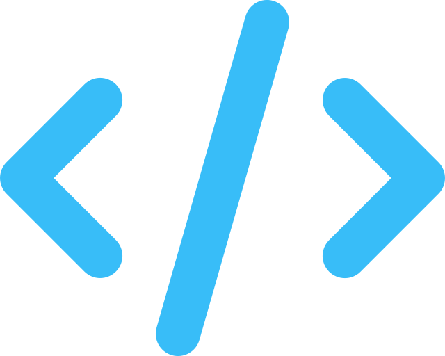
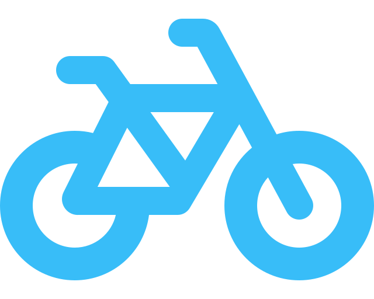
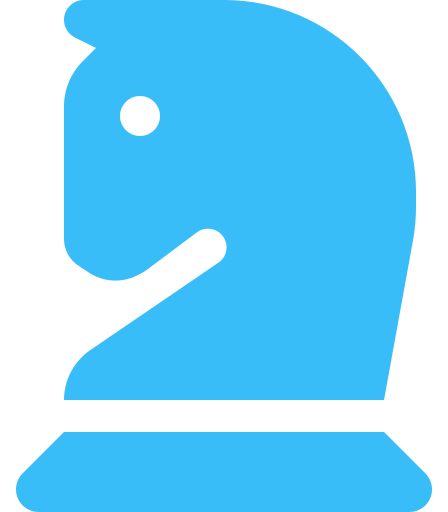
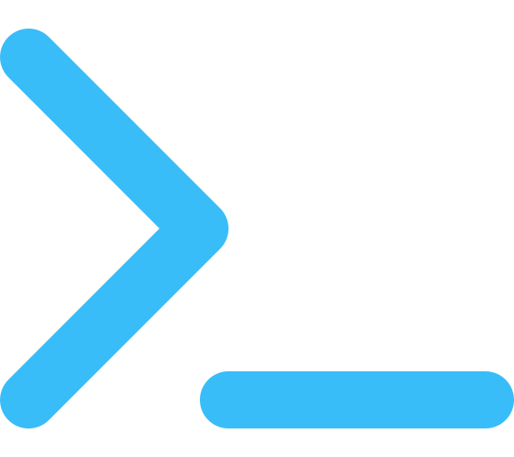
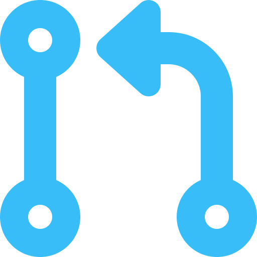

  

  
  
  
  

## Hi, I'm Imran

I study for a master's in computer science (AI) at Université Laval in Québec. The program is a double degree with INSEA in Rabat, where I study data and software engineering.

- I build backends: APIs, databases, and the services behind them.
- My code stays correct under real users and live data.
- I write low-level tools myself, a shell, a compiler, a search algorithm, to learn how each one works.
- I compete in programming contests: Codeforces Expert, top 4% at Meta Hacker Cup 2025.

##  Things I've built

<table>
<tr>
<td valign="top" width="50%">

###  [àVélo Route Optimizer](https://github.com/imranakki/avelo-route-optimizer)
Québec City's bike-share charges you once a ride passes 30 or 45 minutes. Map apps ignore this limit. The planner splits your trip into several rides on the same bike. You re-dock along the way, and the clock resets. The planner also accounts for hills.

Result: across 1,000 sampled trips, overage charges dropped from 49.6% of trips to 0%.

[Live demo](https://avelo.imranakki.com) · `Python` `FastAPI` `OSRM` `Next.js`

</td>
<td valign="top" width="50%">

###  [NexusORM](https://github.com/imranakki/NexusORM)
A small compiler for ORM code. You write your schema in a `.nexus` file. NexusORM generates plain C++ classes, SQL migrations, and a chainable query builder (`.where().orderBy().limit()`) for PostgreSQL.

No runtime reflection. No macros.

`C++20` `PostgreSQL` `libpqxx` `CMake`

</td>
</tr>
<tr>
<td valign="top" width="50%">

###  [OBSIDIAN](https://github.com/imranakki/OBSIDIAN)
A chess engine playing at about 2000 Elo. The search uses minimax, alpha-beta pruning, and quiescence search. Move ordering uses killer moves, the history heuristic, and static exchange evaluation.

[Play OBSIDIAN on Lichess](https://lichess.org/@/OBSIDIANChessEngine) · `Python`

</td>
<td valign="top" width="50%">

###  [nova-shell](https://github.com/imranakki/nova-shell)
A Unix shell I wrote from scratch. nova-shell handles pipes, `<` and `>` redirection, background jobs with `&`, quoting, `$VAR` expansion, and command history. Built-ins include `cd`, `set`, and `history`.

`C` `GNU Readline`

</td>
</tr>
<tr>
<td valign="top" width="50%">

###  [Acadconf](https://github.com/imranakki/Acadconf)
A web platform for academic conferences. Authors submit papers. Reviewers score them. Editors accept, reject, or request revisions. Each role has separate permissions. You export reports to Excel and PDF.

`Java 21` `Spring Boot 3` `MySQL` `Docker`

</td>
<td valign="top" width="50%">

###  [domjudge-cli](https://github.com/AnasImloul/domjudge-cli)
A command-line tool for setting up DOMjudge programming contests. I contributed 2 merged pull requests, about 1,260 lines of code.

`Python` `Typer` `Pydantic`

</td>
</tr>
</table>

##  Competitive programming

| Contest | Result |
|---|---|
| Meta Hacker Cup 2025 | 491 / 13,779 |
| Codeforces | 1647, Expert |
| Moroccan Collegiate Programming Contest 2025 | 18th |
| Moroccan Olympiad in Informatics 2022 | Semi-finalist |

I also set problems for Game of Codes, a national inter-school contest. You find my solutions in [Competive-Programming-Problems](https://github.com/imranakki/Competive-Programming-Problems) and [neetcode-submissions](https://github.com/imranakki/neetcode-submissions).

##  Tools I use

  
   
  

  Email me at <a href="mailto:me@imranakki.com">me@imranakki.com</a>. I'm happy to talk about backends, databases, or a contest problem.

